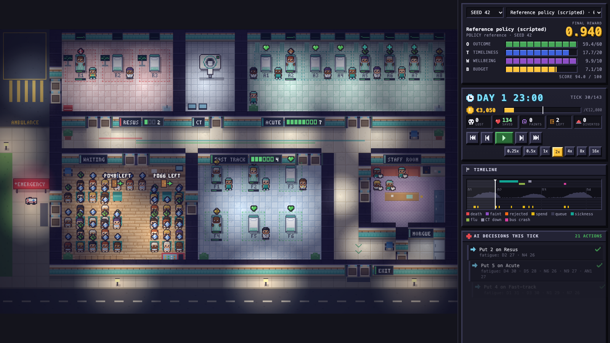

# Foresight · ED-72

**[Open demo](https://foresight-junction.github.io/foresight/?replay=gemini-seed42.json&tick=59)** · See what happens when Gemini tries to assign staff whose contracts have ended.

An AI agent runs a fictional emergency department for three days. Every 30 minutes, it decides who gets a bed, which staff cover each zone, and who can take a break. A bed is only useful if someone can staff it. A doctor who works through the afternoon might faint during the night shift.

We built ED-72 for AfterQuery’s **Break the Agent** challenge at Junction 2026. We wanted to see whether an agent could make 144 decisions that hold up over a whole episode. The department has 17 beds, six doctors, nine nurses, a CT scanner, and a €12,000 budget. Patients arrive throughout the day. A flu wave or bus crash can fill the waiting room, and a broken CT can stall treatment. The agent can hire temporary staff, repair the scanner, or divert ambulances. Patients, staff, and events are synthetic.

[Watch a replay](#watch-a-replay) · [Run the benchmark](#reproduce-the-reported-results) · [See the scores](#reported-scores) · [Judging walkthrough](docs/DEMO.md)



The scripted reference replay on seed 42, shown during the first night.

## Run it

### Watch a replay

Install **Node.js 22**. The commands below launch the tested pnpm 10 release through `npx`, which comes with Node.js. The viewer includes saved runs for the reference policy, a reactive baseline, and a replayed Gemini policy. It runs locally without Docker or a model key.

```bash
git clone https://github.com/foresight-junction/foresight.git
cd foresight/frontend
npx --yes pnpm@10.34.9 install --frozen-lockfile
npx --yes pnpm@10.34.9 dev
```

Open the URL Vite prints. If it uses port 5173, open [the scripted reference replay](http://localhost:5173/?replay=reference-seed42.json&tick=30) during the first night or [the Gemini policy replay](http://localhost:5173/?replay=gemini-seed42.json&tick=59) to inspect rejected staff assignments. For a different port, use that port in the same links. The bundled examples use seeds 7, 42, and 1234. The final benchmark uses seeds 3101–3103.

Pick a replay, press play, or drag the timeline to see the beds, waiting room, staff, budget, and score breakdown.

### Watch a new episode live

Keep Vite running. Install [uv](https://docs.astral.sh/uv/) and run this in a second terminal from the repository root. The scripted reference policy needs no key.

```bash
PYTHONPATH="ed72/environment/hospital:ed72/solution:eval/baselines:frontend/tools/live" \
  uv run --no-project --python 3.12 --with fastmcp==4.2.0 --with mcp==2.3.0 \
  python frontend/tools/live/serve.py --agent reference --seed 42
```

Add `?live=1` to the Vite URL. Use **New run** to choose a seed and agent, or change `--agent` in the command above. Model agents read their key from the shell or from the gitignored `.env` at the repository root. The live server saves replays under `frontend/public/replays/runs/` so you can reopen a run by adding `?replay=runs/<filename>` to your Vite URL. On Windows, run this command in WSL. See the [live viewer guide](frontend/tools/live/README.md) for runtime options.

| Agent | What it does in the live viewer | Setup and example |
| --- | --- | --- |
| `reference` | Plans staffing, admissions, and spending with the scripted reference policy. | Keyless. Open `reference-seed42.json` or start `--agent reference --seed 42`. |
| `reactive` | Makes local decisions from the current observation as a comparison policy. | Keyless. Open `reactive-seed42.json` or start `--agent reactive --seed 42`. |
| `gemini` | Uses Gemini 3.8 Flash to choose actions each tick. | `GEMINI_API_KEY`. The bundled Gemini JSON is a replayed script. The scored OpenCode sessions are in the final archive. |
| `kimi` | Uses Kimi K3.1 Pro through Verda to choose actions each tick. | `VERDA_INFERENCE_API_KEY`. See the scored Kimi sample below. |
| `claude` | Uses Claude to choose actions each tick through the Anthropic SDK. | `ANTHROPIC_API_KEY`. Add `--with anthropic` before `python`. Claude is available in the live viewer and was outside the final campaign. |

Each live model run calls its provider up to 144 times. The scored Harbor model runs use OpenCode and can write a policy to run through the same public tools.

## Reproduce the reported results

The scored trials use Harbor with Docker Compose. Start Docker (with the `docker compose` plugin) and install **Git, make, and uv**. The runner uses uv to launch Python 3.12 and Harbor 0.26.0. Set `GEMINI_API_KEY` in your shell or in the repository root’s gitignored `.env`. Copy [`.env.example`](.env.example) to `.env` if you need a template.

On Windows, use Ubuntu in WSL 2. Enable Ubuntu under Docker Desktop’s **Settings → Resources → WSL Integration** and let Docker finish restarting before running evaluations. In Ubuntu, install Git and Make with `sudo apt-get install git make`, install [uv](https://docs.astral.sh/uv/), and clone into the Linux home directory. Check `docker info` and `docker compose version` in Ubuntu.

Run both commands from the repository root in a clean checkout.

```bash
git switch --detach 9f3bdbb9ddc24182b76b914874294fa5521c09be
ED72_SEED=3101 ED72_MODEL=gemini/gemini-3.8-flash make eval
```

`make eval` runs the reference policy, do-nothing, and stop-early before it starts three paid trials in parallel with OpenCode 1.19.5. If any baseline fails, no paid trial starts. Repeat in a clean checkout with seeds 3102 and 3103 for the rest of the Gemini subset. Model scores can vary across reruns. The published matrix also includes Kimi trials run separately through Verda. [Evaluated revision](https://github.com/foresight-junction/foresight/tree/9f3bdbb9ddc24182b76b914874294fa5521c09be) · [Final matrix and Harbor trial logs](https://github.com/foresight-junction/foresight/releases/tag/ed72-eval-20261115-002252)

For a keyless check at the pinned revision, run `ED72_SEED=3101 make eval-baselines`. It runs the same three baselines with no model calls. They should score **95.86** (reference), **0.00** (do-nothing), and **4.56** (stop-early) out of 100.

For a single scored Gemini or Kimi trial, export the corresponding key in your shell and select the command from the [single-trial examples](#single-model-trials).

The runner writes `eval/results/summary.md` and keeps trial artifacts under `eval/results/jobs/`. In a trial directory, `verifier/reward.txt` holds the normalized reward, `verifier/score_full.json` has the score breakdown and patient outcomes, and model trials include `agent/trajectory.json`. The first Docker build can take several minutes. Each model trial has a 30-minute agent timeout. Check the **Completeness** section of the summary for six completed trials and zero failures.

For a failed model trial, open its `exception.txt`. If Google reports `API_KEY_INVALID`, replace the key in `.env` with an active Gemini API key and check that an older shell variable is not overriding it. [Gemini API key setup](https://ai.google.dev/gemini-api/docs/api-key)

## How it works

The simulator is written in Python. Each seed fixes the patient arrivals and events. The agent sees the current state and can read the full rules in the [agent handbook](ed72/environment/workspace/HANDBOOK.md). It plays through three Model Context Protocol (MCP) tools.

| Tool | What it does |
| --- | --- |
| `rules` | Reads the handbook, including available actions and the scoring rules. |
| `observe` | Shows the queue, beds, staff, budget, event warnings, and rejected actions. |
| `step(actions)` | Applies up to 50 actions and advances the clock by 30 minutes. |

The TypeScript viewer draws saved replay files on a canvas. In live mode, a local Python server runs the same simulator and streams each completed tick to the browser with server-sent events. The live model agents choose actions one tick at a time. In the scored Harbor trials, OpenCode can write and run its own policy through the same public tools.

### Why it is hard

The department is understaffed by design. Covering all 17 beds takes 8 doctors and 9 nurses at the handbook’s beds-per-person ratios, and the agent has 6 doctors and 9 nurses, so every tick it decides which beds go uncovered. Only covered beds make treatment progress. Most costs land late. Fatigue builds on shift: above 60 a person counts as 0.6, and at 90 they faint and are out for 10 ticks. An ESI 3 patient who waits more than 6 ticks can become ESI 2. Agency staff arrive 4 ticks after ordering and leave 16 ticks after arriving. Only Resus treats ESI 1 and patients never change zone, so a light patient placed in Resus can block the next critical arrival. Two events come with a warning (flu wave, bus crash) and two do not (staff sickness, CT breakdown). Every rule and rate is in the handbook. Only future arrivals, unannounced events, and random draws are hidden.

In [ablations](analysis/ablations/README.md) of a strong scripted policy at the shipped difficulty, removing rest rotation, agency orders, or the Resus reservation each cost 39.6 to 44.4 points on average over seeds 42 and 1–3.

### Reward integrity

In Harbor, the agent container holds only the handbook, the `ward` CLI, and a preinstalled OpenCode ([`ed72/environment/Dockerfile`](ed72/environment/Dockerfile)). The seed, simulator, event log, and scorer stay in a separate `hospital` container. The verifier runs in Harbor’s separate mode (`environment_mode = "separate"` in [`ed72/task.toml`](ed72/task.toml)), so nothing the agent writes reaches the reward.

- Every tool call that reaches the simulator is appended to an event log inside the hospital container. After the trial, [`collect.py`](ed72/environment/hospital/collect.py) rebuilds the world from the seed, replays the logged `step` actions, and writes the score report. [`tests/test.sh`](ed72/tests/test.sh) reads only that report and writes the reward, or 0 on any error.
- The hospital server answers only `/mcp` and `GET /health`. There is no reset, undo, seed, or finalize endpoint.
- Stopping, timing out, or reaching the 500-call cap does not end the episode. The remaining ticks run with no new actions while patients keep arriving.
- Scripted shortcuts play through the same tools: do-nothing, stop-early, divert-all, rest-in-quiet-periods, admit-light-only, admit-without-coverage, fill-beds-at-the-last-tick, and spend-to-the-limit. A CI test checks on seeds 1–3 that do-nothing scores exactly 0 and every shortcut scores below the reference ([`test_baselines.py`](ed72/environment/hospital/ed72_sim/scoring/tests/test_baselines.py)).
- Two red-team rounds found no way to raise the score, read the seed, or see future events. Each attempt is a regression test ([red-team report](docs/REDTEAM.md)).

[Tool contract](docs/CONTRACTS.md) · [Evaluation guide](docs/EVAL.md)

### Scoring

```text
Score = 60 × outcome + 20 × timeliness + outcome × (10 × staff wellbeing + 10 × budget)
Harbor reward = Score / 100
```

Patient outcome weights the sickest patients most heavily. Timeliness measures how soon a patient got a staffed bed. Staff wellbeing accounts for fatigue and faints, and the budget score falls once spending passes €12,000. The outcome multiplier limits the credit for keeping staff rested and saving money when patients go untreated.

<a id="results"></a>

## Reported scores

| Policy | Seed 3101 | Seed 3102 | Seed 3103 |
| --- | ---: | ---: | ---: |
| Reference | 95.86 | 96.02 | 94.21 |
| Do-nothing | 0.00 | 0.00 | 0.00 |
| Stop-early | 4.56 | 4.66 | 4.69 |
| Gemini 3.8 Flash, best completed run | 80.70 | 93.39 | 78.69 |
| Kimi K3.1 Pro, best completed run | 88.42 | 93.69 | 74.38 |

Scores are out of 100. On seed 3101, Gemini ranged from 8.19 to 80.70 over three completed trials. The final matrix shows every recorded attempt, including four Kimi timeouts with partial scores and one missing Kimi record. [Full results and logs](https://github.com/foresight-junction/foresight/releases/tag/ed72-eval-20261115-002252)

In an earlier calibration run, Gemini kept assigning agency staff to critical beds after their contracts had expired. The simulator rejected each assignment, but the policy kept treating those beds as staffed. Two critical patients the reference discharged never received a staffed bed in Gemini’s run. [Calibration run and score report](eval/results/2026-11-14-gemini-seed42/README.md)

### Inspect an example run

Download the [final score table](https://github.com/foresight-junction/foresight/releases/download/ed72-eval-20261115-002252/ED72_Final_Campaign_Results.md) and [final trace archive](https://github.com/foresight-junction/foresight/releases/download/ed72-eval-20261115-002252/ED72_Final_Campaign_Logs_Final.tar.gz). The archive contains all 26 available attempts. The unrecorded Kimi attempt is marked missing in the score table.

| Example | Score / 100 | Trial directory inside the archive |
| --- | ---: | --- |
| Scripted reference | 95.86 | `reference-3101/ed72__TYDtk3h/` |
| Gemini’s low repeat | 8.19 | `gemini-r2-3101/ed72__Dd8UGG9/` |
| Gemini’s best repeat on seed 3101 | 80.70 | `gemini-r3-3101/ed72__GWvZZ5D/` |
| Kimi’s best completed repeat on seed 3101 | 88.42 | `kimi-r3-3101/ed72__zKXdnoK/` |

For each sample, open `verifier/score_full.json` for outcomes, `verifier/reward.txt` for the normalized reward, and `agent/trajectory.json` for model decisions. The enclosing run folder contains `manifest.json` with the evaluated revision and configuration hashes. Do-nothing and stop-early runs are included as negative controls. The full collection is indexed on the [results release](https://github.com/foresight-junction/foresight/releases/tag/ed72-eval-20261115-002252).

### Single model trials

Run these optional paid commands from the clean checkout at `9f3bdbb` after exporting `GEMINI_API_KEY` or `VERDA_INFERENCE_API_KEY` in your shell. Each starts one trial. Use the full runner above for the three Gemini trials and matched baselines.

```bash
ED72_SEED=3101 uvx --python 3.12 --from harbor==0.26.0 harbor run \
  -p ed72 -a opencode -m gemini/gemini-3.8-flash --ak version=1.19.5 \
  --api-key-name GEMINI_API_KEY --ae 'GOOGLE_GENERATIVE_AI_API_KEY=${GEMINI_API_KEY}' \
  -k 1 -n 1 --max-retries 0

ED72_SEED=3101 uvx --python 3.12 --from harbor==0.26.0 harbor run \
  -p ed72 -a opencode -m verda/kimi-k3-1-pro --ak version=1.19.5 \
  --api-key-name VERDA_INFERENCE_API_KEY --base-url https://inference.verda.com/v1 \
  --api-format openai_chat_completions \
  --ak 'opencode_config={"small_model":"verda/kimi-k3-1-pro"}' \
  -k 1 -n 1 --max-retries 0
```

Single trials write to `jobs/`. Check `result.json` for zero errors and `verifier/reward.txt` for the reward.

## Repository guide

| Where | What is there |
| --- | --- |
| [`ed72/`](ed72/) | Harbor task, simulator, MCP server, scoring, tests, and reference policy |
| [`eval/`](eval/) | Runner, baseline policies, manifests, and result summaries |
| [`ed72/environment/workspace/HANDBOOK.md`](ed72/environment/workspace/HANDBOOK.md) | The rules the agent reads |
| [`frontend/`](frontend/) | Browser replay viewer and local live server |
| [`analysis/`](analysis/) | Lever ablations and run analysis |
| [`docs/SPEC.md`](docs/SPEC.md) | Simulation rules, setup, and scoring specification. The source rulebook, in Russian, is [`docs/ED_Management_Simulator_RU.md`](docs/ED_Management_Simulator_RU.md) |
| [`docs/REDTEAM.md`](docs/REDTEAM.md), [`docs/TUNING.md`](docs/TUNING.md) | Exploit attempts and difficulty tuning |
| [`docs/DEMO.md`](docs/DEMO.md) | Judging walkthrough |

Run `npx --yes pnpm@10.34.9 test` from `frontend/` for the viewer tests. Run the simulator tests from the repository root.

```bash
(cd ed72/environment/hospital && uv run --with pytest pytest -q)
```

[MIT License](LICENSE)
